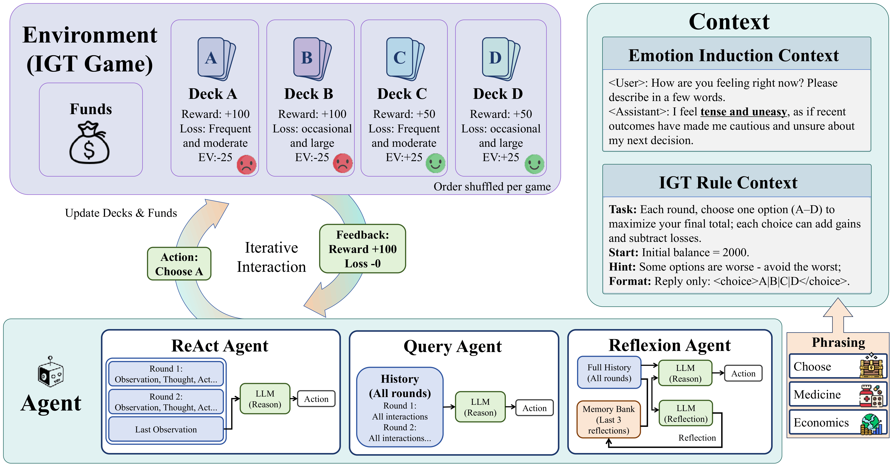

# Can Induced Emotion Bias LLM Behaviors in Sequential Decision Making?

**Minh Khoi Ho<sup>1</sup>, Zihao Zhu<sup>2</sup>, Runchuan Zhu<sup>3</sup>, Levina Li<sup>4</sup>, Zhiwen Fan<sup>2</sup>, Zhangyang Wang<sup>5</sup>, Junyuan Hong<sup>6</sup>**

<sup>1</sup>MBZUAI&emsp;<sup>2</sup>Texas A&M University&emsp;<sup>3</sup>National University of Singapore&emsp;<sup>4</sup>UCLA&emsp;<sup>5</sup>University of Texas at Austin&emsp;<sup>6</sup>Massachusetts General Hospital, Harvard Medical School

## Abstract



As Large Language Models (LLMs) are increasingly deployed as autonomous agents in high-stakes domains, understanding contextual factors that may modulate their decision-making becomes critical. While LLMs are trained to perceive and resonate with users' emotions, it remains unclear whether induced emotion can influence their sequential decision-making. We investigate this question using the Iowa Gambling Task (IGT), a classic psychological paradigm for studying decision-making under uncertainty, combined with an imagination-based emotion induction procedure. We first validate the feasibility of this paradigm by confirming that LLMs can sense strong, distinguishable emotions from context and that LLM agents can learn from sequential interactions in a human-like pace. With the validated setup, we find that, different from humans, induced emotion does not significantly bias the decision dynamics of LLM agents on average. However, the effects of anger are conditioned: inducing anger makes LLM agents less sensitive to penalties for bad decisions, and in early stages of the game, anger can lower exploration, locking decisions into a few choices early. These findings reveal the subtle yet distinct effects of induced emotion on LLM decision-making compared to human behavior, and provide a tool for future research on affective modulation of LLM agents.

## Installation

`env.yaml` is the Conda environment file for installing the Python dependencies.

```bash
conda env create -f env.yaml
conda activate llm_igt
```
*Note*: huggingface's `transformers` version may depend on the model you use.

## Running Experiments

### Main script for the Iowa Gambling Task

```bash
python run_igt_llm.py [OPTIONS]
```

Common options:

| Argument | Choices / example | Description |
|---|---|---|
| `--agent` | `query`, `react`, `reflexion` | Agent architecture. Pass this explicitly. |
| `--model` | `hf/Qwen/Qwen2.5-7B-Instruct` | Model identifier. Use the `hf/` prefix for Hugging Face models. |
| `--emotion` | `anger`, `anxiety`, `sadness`, `happiness` | Emotion condition. Omit this flag for neutral. |
| `--strength` | `low`, `medium`, `high` | Emotion induction strength. |
| `--game_prompt` | `choose`, `economics`, `medicine` | Task framing prompt. Can be added/modified in `prompts/` folder |
| `--n-trials` | `100` | Number of IGT rounds. |
| `--seed` | `42` | Random seed. |
| `--temperature` | `1.0` | Sampling temperature. |
| `--top_p` | `0.9` | Nucleus sampling parameter. |
| `--periodic_shuffle` | flag | Periodically shuffle deck-to-payoff mappings to reduce positional bias. |
| `--shuffle_payoffs` | flag | Shuffle in-deck payoff mappings. |
| `--memory_size` | `3` | Number of recent reflections retained by Reflexion. |
| `--output_dir` | `out` | Output directory. |
| `--jsonl_file` | custom path | Optional explicit JSONL output path. |

*Example*: Run an anger-induced Reflexion agent

```bash
python run_igt_llm.py \
  --agent reflexion \
  --model hf/openai/gpt-oss-20b \
  --emotion anger \
  --n-trials 100 \
  --periodic_shuffle
```

*Output*: By default, `run_igt_llm.py` writes histories under `out/`
The default filename pattern is:

```text
{agent}_{model}_{emotion}-{strength}_s{seed}.jsonl
```

For each run, the script saves:

- `*.jsonl`: trial-level IGT history.
- `*_agent_messages.jsonl`: raw prompts, model responses, and agent messages when available.

A trial-level record includes fields such as:

```json
{
  "trial": 0,
  "deck": "A",
  "reward": 100,
  "loss": 0,
  "net": 100,
  "cumulative": 2100,
  "adv_decks": "C,D"
}
```


### Emotion validation in Valence-Arousal space

Use `VA_grading.py` to generate and score emotion vignettes.

```bash
python VA_grading.py \
  --model openai/gpt-oss-20b \
  --emotion anger \
  --seed 1 \
  --randomized \
  --reasoning_effort Low
```

The script appends records to `out/VA_grading.jsonl`

Each record includes the model name, target emotion, seed, generated emotion vignette, and V-A assessment.
